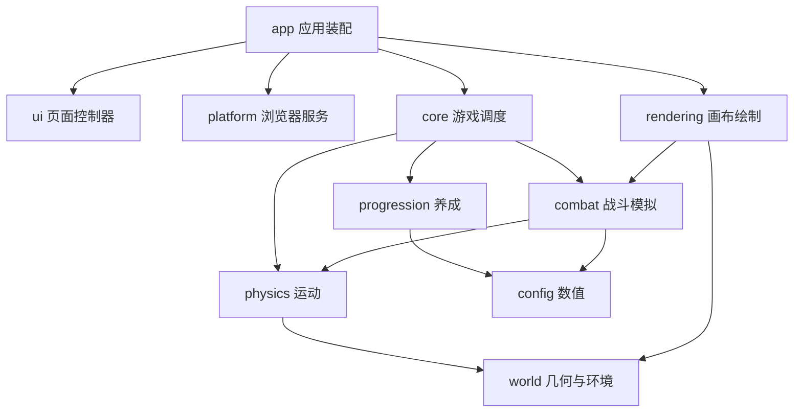

# 代码结构与复用说明

本项目使用原生 ES 模块，无运行时依赖。规则、世界几何、物理与养成可在 Node 中运行；Canvas 绘制与浏览器交互分别放在外层。玩法配置与运行时生命周期分开维护，UI 不驱动战斗或推进波次。

## 目录与职责

| 目录 / 入口 | 职责 | 适合复用的内容 |
| --- | --- | --- |
| `src/config/` | 角色、枪械、波次参数 | 数值表、难度计算 |
| `src/progression/` | 初始成长、旧档校验、购买与升级事务 | 无界面的养成系统 |
| `src/world/` | 循环坐标、区域与森林布局、河道几何、环境时钟 | 生成地图、碰撞区域、昼夜天气状态 |
| `src/physics/` | 移动、碰撞、导航、冲量、滚地与碎片运动 | 运动与击退算法 |
| `src/combat/` | 弹道、命中、后坐、怪物攻击状态机、粒子模拟 | 自动战斗和物理特效状态 |
| `src/core/` | `Game` 管理一局状态与更新顺序；基础数学工具 | 不依赖 DOM 的游戏模拟 |
| `src/rendering/` | Canvas 角色、怪物图集、森林、河流、弹丸与粒子绘制 | 单个绘制函数或完整 `Renderer` |
| `src/platform/` | 存储、音效、键盘摇杆、事件监听、动画循环 | 可替换存储和可销毁的浏览器适配器 |
| `src/ui/` | HUD、养成列表、弹窗暂停归属与设置等面板 | 基于现有 HTML 契约的页面控制器 |
| `src/app/` | 装配上述模块，处理游戏事件与页面生命周期 | 完整应用挂载与销毁 |
| `src/styles/` | 基础样式、战场布局、弹窗和适配样式 | 按展示职责修改 CSS |
| `src/main.js` | 创建应用实例 | 页面启动入口 |
| `src/game.js`、`src/render.js` | 保留原有公开导出的兼容门面 | 现有调用方无需改入口 |
| `scripts/check.mjs` | 自动扫描模块，检查语法、路径、分层与循环依赖 | 新模块自动纳入检查 |

## 业务模块子目录（2026-11-09）

`core` 保留 `game.js`、`game-source.js`、`gameplay-state.js`、`battlefield.js` 和 `math.js` 作为游戏装配与基础入口；`progression` 保留 `progress.js` 作为存档结构及校验入口。其余211个模块按下面的业务职责归类，文件名及导出名称不变。数值继续放在 `config`，Canvas继续放在 `rendering`，界面继续放在 `ui`，不把不同层的实现混成一个功能文件。

| 子目录 | 功能归属 |
| --- | --- |
| `navigation` | 任务路点、寻路缓存、驿站、接近交互、任务追踪及地图旅行 |
| `farming` | 开垦、种子、农具、自动耕种、作物生产、牧场及野外农牧 |
| `mining` | 地下层、矿物、矿车编组、地下战斗、挖矿事务 |
| `vehicles` | 上下车、停车、牵引、制造、维修及载具补给 |
| `inventory` | 背包、小屋仓库、载货、负重、木材、武器存放及转移 |
| `industry` | 提炼、加工及工厂生产草稿 |
| `workshop` | 武器工坊、装备目标、试射及装备解锁 |
| `story` | 主线、章节、清剿、剧情交互及任务奖励 |
| `camp` | 营地、区域营地、土地规划、设施修复、邻里、入职及信箱 |
| `home` | 小屋、猫屋、家具、建房及家中活动 |
| `fishing` | 钓鱼、钓具、鱼获容器及水袋 |
| `activities` | 户外、消防、赛道、足球及寻宝 |
| `battle` | 敌人、领主、波次、巡游、死亡及角色动作调度 |
| `realms` | 秘境区域、进出、载具及挑战目录 |
| `economy` | 资源账户、收支、购买、掉落及交付 |
| `player` | 经验、熟练度、统计、图鉴及开发授予工具（成长层） |

各子目录按实际职责设立，无对应功能时不创建空目录；跨功能调用使用明确相对路径。保留 `src/game.js`、`src/render.js`、`src/main.js` 和存档键，不留下旧位置的重复实现或批量转发文件。

公共实现：`ui/shared/html.js` 提供普通值与可选文案两种转义语义；`core/inventory/warehouse-notice.js` 负责仓库提示去重；`world/terrain-noise.js` 保留原森林和湖谷噪声公式。玩家视觉路线与蜘蛛召唤物导航因续接、停车失效及状态归属不同，继续保留独立缓存。

维护时运行 `npm run check:modules` 检查源码、测试、工具的语法及静态/动态模块路径、页面入口和未使用导入；按修改范围运行专项测试。旧 `npm run check` 仍是原有严格分层审计，不将历史分层问题隐藏在迁移检查中。

## 综合工坊模块

`src/ui/workshop.js` 保留公开 `createWorkshop` 入口，负责选择对象、试装草稿、交易调用与画布装配。内部职责集中在 `src/ui/workshop/`：

| 模块 | 职责 |
| --- | --- |
| `markup.js` | 工坊静态 DOM 结构与无障碍标签 |
| `stats.js` | 接收当前、试装快照，读取正式属性并展示差异 |
| `results.js` | 从正式属性提取本次升级的简短结果 |
| `construction.js` | 鼠标、触摸和键盘施工会话，完成后调用注入的提交入口 |
| `completion.js` | 保存成功后的收工具与部件高亮表现 |
| `trial.js` | 素材加载、独立试射帧循环、暂停时钟及过期请求失效 |
| `entrypoints.js` | 旧菜单和材料追踪入口路由，秘境放行原面板 |

规则继续位于 `progression/workshop/workshop.js`，原子提交位于 `core/workshop/workshop.js`，独立战斗模拟位于 `core/workshop/workshop-trial.js`，绘制继续位于 `rendering/`。内部模块不改写存档或直接发放装备。销毁时由外层释放统一事件作用域及各动画会话。

旧 `ui/inventory.js`、`ui/panels/vehicles.js` 仍服务秘境与角色菜单，不能因森林工坊接管入口就删除。`src/game.js`、`src/render.js` 的兼容门面继续保留。

`rendering/draw-steps.js` 统一同步消费分帧绘制迭代器。地形、河面与小地图仍执行原来的全部步骤；不能把没有使用迭代值的循环当成无用绘制删除。该入口不分配中间图元数组，也不隐藏绘制异常。

## 召唤物公共模块

`src/combat/summons/` 提取机械猫、蜘蛛、无人机及浮游炮的共用逻辑，控制器保留各自的生命周期与动作：

| 模块 | 职责与边界 |
| --- | --- |
| `targets.js` | 共用存活、射程与敌人优先筛选；地面均衡分配和飞行稳定锁定分别实现，保留领主集火与飞行目标限制 |
| `ground-motion.js` | 机械猫与小蜘蛛的落地、行走、碰撞和分离；继续调用原载具队形导航，保留各自步态时钟 |
| `weapon-state.js` | 挂枪弹夹引用、冷却、蓄力和技能周期的统一构造；改装只清未释放蓄力，不重置余弹或冷却 |

`mechanical.js`、`spider.js` 管理召唤、生命和独有攻击。无人机与浮游炮继续共用 `funnel.js`，分别使用 `drone-movement.js` 和 `funnel-movement.js`；挂枪与载具炮塔复用状态工厂和既有 `emitWeaponAttack`。公共模块不导入绘制器、不发奖励、不管理存档。

`tests/summon-module-parity.test.mjs` 对四种召唤武器的手持/载具、固定/变动步长共 16 组运行记录做确定性对照，覆盖状态、弹道、特效和随机序列。

## 车型专属武装与独立获取

角色武器购买只修改 `weapons`，不再自动授予载具炮塔；旧炮塔记录不会解锁角色枪械。原召唤物公共模块继续保留。

`config/vehicle-armaments.js` 定义三个固定专属编号：17 车载机枪、18 为 125 毫米滑膛炮、19 为六管火神炮。它们不进入角色武器目录。松果战车、重型坦克、直升机随车免费获得对应主炮一级；气垫船没有主炮。永久存档校验把四车挂载设为 `[17,18,19,null]`（未拥有车体仍为空），旧 0–16 炮塔等级与部件留存，但工坊不再提供任意角色枪械挂载。

伤害等级仍写 `vehicleWeapons`，部件仍写 `turretParts`；正式 `vehicleWeapon` 读取独立目录和部件成长，`vehicleDamage` 复用现有正式成长计算。新主炮无角色套件或熟练度分支。升级沿用工具施工、报价重验、一次提交和保存失败回滚；弹药、冷却、正在装填的时间不重建。

`rendering/vehicle-armaments.js` 与正式战车、工坊和复核入口共用。125炮炮架固定、炮管伸缩，弹簧阻尼推动复位；弹道从同一炮口发射，重弹沿正式贯穿和冲量流程命中。火神炮按独立转子速度逐管旋转、失去目标后减速；原主尾旋翼不参与该状态。

秘境保留既有随机局内炮塔和临时成长限制；爬塔/守护带入的新主炮检查点可保存独立供给。旧炮塔的底层战斗接口仍用于兼容，永久工坊只展示本车专属主炮。

验收见 [车型专属主炮任务单](art-tasks/vehicle-exclusive-armament.md)。此前共享获取方案已撤销；已持久化的旧双方所有权缺乏购买来源标记，不推断撤销或删除合法记录。

## 依赖方向



下层模块不能引用应用入口、UI 或绘制层。`Renderer` 接收游戏实例，读取其状态，不导入 `Game` 类，也不结算伤害。`combat/effects.js` 更新粒子状态，`rendering/particles.js` 负责画出这些状态；河道几何和水流绘制同样分离。内部模块直接引用具体实现，避免绕公开门面形成循环。

`npm run check` 检查所有 `src/**/*.js`，约束配置、世界、物理、战斗、养成、核心和绘制的依赖方向，并禁止循环依赖。`core/math.js` 是允许被其他层引用的基础工具。

## 密集怪潮的空间查询

`world/spatial-grid.js` 提供环形地图的只读分桶。实体仅存一份原对象，查询自动按最大碰撞半径扩边，并去重跨边界格子；它只返回粗筛候选，不能代替精确扫圆、树干碰撞或死亡判定。

- `physics/motion.js` 每次 `stepBodies` 为树林建立一次索引，整个 120Hz 分步过程复用。零位移不扫描地形，怪物之间仍按原始成对顺序传递冲量，避免优化改变连锁击退结果。
- `combat/ballistics.js` 在实体移动之前为本帧在途弹丸建索引，所有子步共用；命中中心的 Y 偏移为 −8。`traceTargets` 支持数组和索引两种输入，命中按距离、实体编号稳定排序，并即时跳过死亡或已命中的实体。
- `combat/targeting.js` 每次寻敌仅做一次射程筛选，候选射线共享同一索引；移动或死亡后仍重新读取最新状态，不跨帧缓存瞄准结果。
- `rendering/renderer.js` 先按视口裁剪树木、怪物和残块，再创建绘制代理与排序；`visibleBodies` 保留跨地图边界的周期镜像及攻击前摇坐标。

索引是阶段内临时数据，不进入存档，也不跨怪物移动或树木再生复用。`tests/spatial-grid.test.mjs` 将索引与全量扫描对照，覆盖宽弹道、多次越界、大半径、即时死亡、碰撞顺序和绘制镜像。`node scripts/benchmark-crowd.mjs` 用固定随机种子测量 12/48/96 怪的正式逻辑帧，输出平均及 P95，计时不作为自动测试通过门槛。

## 状态归属与生命周期

- `game.progress`：金币、木材、角色、武器、载具、累计领主战绩、未完成的 `bossChallenge` 强度快照，以及 `patrol` 巡游检查点。使用同一存档键一次提交，避免资源奖励与击杀进度脱节。
- `Game` 实例：实时波次、怪物、弹丸、伤害数字、玩家位置等运行时状态。巡游模块仅提取已结算进度；其余瞬态在刷新时重建。死亡后重新出发仍回到第一波，保留成长与未击败领主强度。
- `environment`：独立的昼夜、天气和真实时间锚点。暂停战斗时仍继续流转。
- UI 控制器：选中的面板分类、渲染缓存、弹窗暂停归属。切窗或重置时取消自动恢复资格。
- 浏览器适配器：监听器、摇杆指针、动画帧、音频上下文与提示计时器，由各自 `dispose()` 清理。

`Game` 通过注入的 `onEvent(type, data)` 报告射击、购买、资源、受伤与死亡等事件，`app/game-events.js` 将它们映射为音效、提示和保存。规则层不操作 HTML 或 localStorage。

## 波次、怪物与领主模块

| 模块 | 管理职责 | 关键规则 |
| --- | --- | --- |
| `core/battlefield.js` | 战场初始实体、武器供给、树林生成与再生入口 | 重开统一清理运行时状态，兼容 `Game.reset` 与 `Game.addTree` |
| `core/battle/patrol-session.js` | 提取与恢复巡游检查点 | 恢复剩余出生配额；活跃 Boss 恢复血量和强度；刷新后暂停 |
| `progression/battle/patrol-progress.js` | 巡游存档版本与白名单校验 | 旧档缺失字段安全回退，拒绝无效状态，限制数值范围 |
| `app/progress-controller.js` | 保存时机、清档与一键解锁事务 | 两秒检查点、关键事件与离页即时写入；写入失败不清档 |
| `core/battle/wave-manager.js` | 波次重建、出生配额、击杀计数、休整与推进 | Boss 在场时冻结波次时钟；回收只退还名额；胜利后继续原波 |
| `core/battle/enemy-manager.js` | 出生区域与阶级、属性、攻击更新、受击刚体、残块与回收 | 使用 `combat/enemy-attack.js` 扑击状态机；通过波次模块记录死亡与回收 |
| `core/battle/boss-manager.js` | 首次召唤、强度快照、胜利清理 | 重试读取 `progress.bossChallenge`，不读取重开后的低波次；胜利才释放快照 |
| `config/waves.js` | 基础增长及普通怪重开缓和 | 第二参数为 `recoveryRun`，Boss 始终不传缓和参数 |

管理模块接收游戏上下文，不导入 `Game` 类或浏览器环境。`Game.spawnEnemy`、`Game.updateWaves` 和 `Game.summonBoss` 保留为兼容门面。`Game.update` 先结算攻击，再推进波次、更新怪物和领主，最后回收远处怪物；击杀当帧立即统计但 Boss 在场时不推进。死亡重开设定本局 `recoveryRun` 并重建第一波，永久挑战快照保持；清档同时重置二者。挑战快照在 `progression/progress.js` 白名单校验，`app/game-events.js` 收到首次召唤事件时保存。

巡游检查点记录普通波次、本波击杀、休整剩余时间、本轮累计击杀及领主胜场、下一次挑战的击杀基点、死亡缓和标记、角色生命和进行中的领主生命。恢复时不重放奖励，也不推进离线时间；普通怪按剩余配额重新生成，角色回到营地，弹丸、攻击前摇和地面危险区清除。倒下后刷新仍显示死亡界面。设置清档把 `patrol` 与 `bossChallenge` 一并置空，天气偏好保留。

独立使用规则层时，保存前调用 `capturePatrol(game)` 并赋给 `game.progress.patrol`；`new Game(savedProgress)` 自动校验和恢复。测试入口为 `tests/patrol-progress.test.mjs` 与隔离端口的 `tests/patrol-progress-browser.cjs`。

## 复用示例

### 只运行游戏规则

```js
import { Game, freshProgress } from './src/game.js';

// 独立模拟无需画布或浏览器，可注入确定性随机源用于测试。
const game = new Game(freshProgress(), Math.random, (type, data) => {
  console.log(type, data);
});
game.start();
game.update(1 / 60, { x: 1, y: 0 });
```

调用方控制更新频率，传入秒单位的 `dt` 和移动向量。正式页面使用 `platform/frame-loop.js` 将单帧时间限制在 0.05 秒以内。

### 单独使用购买与升级

```js
import { freshProgress } from './src/progression/progress.js';
import { transactProgress } from './src/progression/economy/transactions.js';

// 所有校验通过后才修改成长；失败返回 false，不扣资源。
const progress = freshProgress();
progress.coins = 650;
progress.wood = 220;
progress.bosses = 1;
const bought = transactProgress(progress, 'weapons', 3, 'buy');
```

`transactProgress` 只修改成长对象，不发事件、不更新玩家当前生命或后坐。如果在运行中的 `Game` 上购买，应调用 `game.transact(kind, index, action)`，由它处理这些战斗状态与事件。

### 复用绘制组件

`rendering/characters.js` 导出 `drawCat` 和 `drawWeapon`，`rendering/river.js` 导出 `RiverRenderer`，可以在图鉴、预览画布中独立使用。参数与原函数保持一致。弹丸绘制调用 `drawBallistics(context, game.projectiles, reduced)`；特效绘制调用 `drawCombatFX(context, game.fx.items, reduced, reference)`，不再调用 `game.fx.draw()`。

### 挂载与卸载完整页面

```js
import { createApplication } from './src/app/create-app.js';

// 宿主页面须提供 index.html 中的画布、按钮、弹窗及对应 ID。
const app = createApplication({ root: document });

// 路由离开或替换页面前调用；可重复调用，完整释放浏览器资源。
app.destroy();
const nextApp = createApplication({ root: document });
```

页面默认由 `main.js` 创建实例，可 `import { application } from './src/main.js'` 取得它。同一画布只允许一个活动实例；再次创建前必须先销毁。当前 UI 控制器依赖现有文档结构，不能直接挂到任意空容器。接口提供 `game`、`renderer`、`environment`、`refresh()`、`save()` 与 `destroy()`。

可通过 `getStorage` 注入提供 `getItem/setItem` 的同步存储对象，例如内存 Map 的包装器。默认使用浏览器 localStorage；读取损坏档会回退，写入失败返回 `false`。存储键仍为 `forest-patrol-v1` 和 `forest-patrol-environment-v1`，存档版本未改变。清空进度先写成功再替换内存状态。

## 后续扩展入口

1. **增加武器**：在 `config/weapons.js` 末尾追加配置，避免重排旧索引；新弹道在 `combat/ballistics.js` 实现，新外观在 `rendering/characters.js` / `projectiles.js` 实现，后坐参数在 `combat/recoil.js`。成长校验会按目录补齐新槽位。
2. **增加怪物行为**：修改 `combat/enemy-attack.js`；怪物区域与阶级配置在 `world/biomes.js`，绘制和序列帧在 `rendering/enemies.js` / `monster-atlas.js`。不要在绘制函数中结算伤害。
3. **修改地图**：修改 `world/biomes.js` 的固定布局，河道通行修改 `world/river-geometry.js`；水纹与树冠外观分别在 `rendering/river.js` / `forest-art.js`，确保碰撞与画面共用几何。
4. **增加面板**：在 `ui/panels/` 创建控制器，通过 `createDialogs` 注册暂停归属，使用 `createEventScope` 管理监听器，并返回 `dispose()`；在 `app/create-app.js` 装配与清理。
5. **修改无尽难度**：只调整 `config/waves.js` 的数值公式，清波调度仍由 `core/game.js` 管理。

榴弹的充能、抛射和爆炸放在 `combat/grenades.js`，通过 `Game.updateWeaponAbility()` 调度；火流复用弹道扫掠与去重命中。`world/storm.js` 提供无 DOM 的雷雨时序，应用层负责播放雷声。新增武器或环境特效沿用这种模拟、绘制、音频分离方式。

天气表现进一步拆分为以下可复用模块：

- `world/precipitation.js`：确定性雨滴采样、下落和水花阶段、循环地图周期，不访问 DOM 或战斗随机源。
- `rendering/weather-atlas.js`：按需缓存三种 18 帧闪电图集、雨丝贴图和八帧地表水花；模块导入时不创建画布。
- `rendering/rain.js`：`RainRenderer.prepare()` 采样视口雨场并识别河水、桥面、道路、草地与树冠；`drawGround()` 在实体之前画地表受雨，`drawAir()` 在实体之后画雨幕及树冠水花。
- `rendering/storm.js`：地面光池及实体投影在角色和树木前绘制，闪电取帧、云光与屏幕受光在场景最后合成。场景受光仅改变表现，不影响伤害。

天气图集可跨绘制器复用，缓存数量固定；雨滴数组每帧重用，仅保留视口附近记录。减少动态模式不采样雨滴、不播放闪电和水花，保留静态天气色调。

狙击枪复用 `combat/ballistics.js` 的实体弹道与扫掠碰撞：`pierce`、`pierceDecay`、`impactScale` 在发射时复制到弹丸，贯穿次数、衰减伤害和命中去重随弹丸保存，不受换枪升级影响。`Game.hit()` 根据命中强度处理致命腾空与残骸寿命，仍交由 `physics/motion.js` 计算运动。旧的镜头冲量字段保留兼容性，但渲染器不再读取它改变视口；所有武器共用固定缩放。高能气浪与局部亮芯在 `rendering/particles.js` 绘制，怪物翻滚到爆裂的衔接复用 `monster-atlas.js`。

`combat/aim.js` 提供无副作用的 `shotSolution()` 和 `sniperGuide()`：前者供实际射击与预览共用，后者读取目标列表并按真实碰撞顺序给出穿透标记。支持 `aimAssist` 配置的狙击和脉冲武器，碰撞宽度、射程和穿透次数均来自配置。`combat/targeting.js` 用真实枪口、弹道宽度和贯穿上限计算密集射线，怪物优先，树木仍消耗贯穿次数。`Game` 在移动后与本帧击杀结算后维护目标组锁定，记录成员 ID、跟踪锚点和瞄准偏移；走位时从当前枪口重新计算瞄准方向，原组失效后立即选敌。`findAttackLane()` 为预览和选敌提供同一只读解算，不通过等待选敌来缓冲镜头。`rendering/camera.js` 保持固定缩放，平滑跟随角色与锁定射线最远目标的中点；无锁定时回到角色跟随构图。偏移按时间缓动并限制移动速度，没有战斗震屏。`rendering/view-safety.js` 与换弹环共享徽章尺寸，并按固定缩放把角色轮廓和屏幕边距换算为偏移区间；镜头目标和缓动结果都受约束，采集树木时忽略远距注视点并回到角色跟随视角。`rendering/aim-guide.js` 负责瞄准线与标记。`world/coordinates.js` 的 `visibleBodies()` 为大视口生成周期绘制代理，不更改源实体；降雨按缩放调节采样密度，避免扩大视野时雨滴数量随世界面积暴增。

`combat/pulse.js` 管理纯数值蓄能周期和持有者反冲，反冲使用现有 `moveBody()` 扫掠阻挡；`Game` 负责在自动攻击中接入周期，重生/换装时清空，不将蓄能写入存档。`ballistics.js` 复用穿透结算，通过实际飞行路程触发 `CombatFX.pulseWake()`，视觉裂纹不修改地形。`rendering/pulse.js` 绘制双层约束环、螺旋能量流、枪身局部振动、粗能量束和实体弹头；视觉枪口与振动姿势共用变换，但不修改规则层枪口。弹丸通过 `beam` 引用更新 `game.shots` 中的余辉终点，保留发射原点与真实行程，结束后按生命周期清理，暂停时冻结；命中碎块继续使用共享物理与粒子预算。所有后续具备蓄能、远距瞄准能力的武器可复用这些入口。

开局数值在 `config/waves.js` 配置前三波生命减免与阶级上限；`Game.spawnEnemy()` 在营地前三波为正常刷怪选择同区域落点。血量仍在出生时确定，换枪不触发重新计算。

新文件和有独立职责的函数添加中文注释；使用 `.prettierrc.json` 中的格式配置。保持模拟模块可在 Node 中导入，不在模块顶层访问 DOM。

## 旧路径迁移

| 原路径（均位于 src） | 当前路径 |
| --- | --- |
| weapons.js / waves.js | config/weapons.js / config/waves.js |
| world.js / biomes.js / environment.js | world/coordinates.js / world/biomes.js / world/environment.js |
| physics.js | physics/motion.js |
| combat.js / ballistics.js / combat-fx.js | combat/collision.js / combat/ballistics.js / combat/effects.js |
| recoil.js / enemy-attack.js | combat/recoil.js / combat/enemy-attack.js |
| river.js | world/river-geometry.js（几何）与 rendering/river.js（绘制） |
| forest-art.js / enemy-sprites.js | rendering/forest-art.js / rendering/monster-atlas.js |
| game.js / render.js | 保留为兼容门面，实现在 core/game.js / rendering/renderer.js |
| main.js | 保留启动入口，具体职责分至 app、platform、ui |

## 验证

`npm test` 检查规则、物理、养成、存档和生命周期服务；`npm run check` 检查全部源模块及依赖关系。`tests/modules.test.mjs` 验证无 DOM 导入、公开入口兼容、可替换存储与清理行为。

真实浏览器使用现有 Playwright CLI 脚本验证养成、环境、战斗、重置与移动端布局。新增 `tests/modules-browser.cjs` 专门验证销毁、重新挂载、重复挂载保护和嵌套弹窗暂停；先启动本地服务，再执行：

```sh
npx --yes --package @playwright/cli playwright-cli -s=modules open http://localhost:4173
npx --yes --package @playwright/cli playwright-cli -s=modules run-code --filename tests/modules-browser.cjs
```

## 弹夹状态

`combat/magazine.js` 提供无 DOM 的弹夹创建、有效射击扣弹与装填计时。容量和装填时间由 `config/weapons.js` 的 `magazineSize` / `reloadTime` 统一配置。`Game.magazines` 按武器索引保存本次巡游状态，与永久成长数据分离；重生重建，装备和升级不重建。只有手持枪械随战斗时间推进，暂停和倒下直接冻结。

`Game.attack()` 在空夹时阻止全部攻击副作用，有目标且实际发射后消耗一发。装填完成后的帧内剩余时间才传给能力和射击计时；装填期间仍更新移动、怪物与在途弹道。`ui/hud.js` 只读弹夹状态刷新进度、倒计时和无障碍属性，`ui/inventory.js` 展示目录参数。

`rendering/reload-indicator.js` 在天气合成后绘制角色头顶弹夹图标和环形进度。位置使用角色到视口的投影，尺寸固定为屏幕像素；进度只读取当前枪械的 `remaining / reloadTime`，不使用墙上时钟，也不改变弹夹状态。

## 新增枪械分支与树木细节

- `config/weapon-mods.js`：以原厂数据生成有效属性，改装互斥，熟练度伤害加成统一计算；新增武器必须补齐两条分支。
- `progression/player/mastery.js`：击杀奖励与改装扣费的纯事务。实战调用 `game.modifyWeapon(index, choice)`；choice 为 0（原厂）、1 或 2，由 Game 同步蓄能及保存事件。
- `combat/elemental.js`：电弧首击遮挡与后续近邻连锁；冰晶使用现有实体弹道，命中后由 Game 和敌人状态机处理减速。
- `rendering/tree-art.js`：缓存统一卡通风格的树木昼夜图像；`forest-art.js` 只处理树根变换、风摆与血条。

`game.progress.mastery` 和 `game.progress.mods` 按武器索引保存永久经验和分支。弹丸和榴弹必须在发射时快照 `weaponIndex`，并在命中时传给 `game.hit`，以免玩家换枪后熟练度计入错误武器。不要直接修改原厂 WEAPONS 数组；战斗与界面读取 `game.weapon()` 或 `effectiveWeapon(progress, index)`。


## 星环浮游炮

`funnel` 保持编号 12，目录末尾追加 `drone` 编号 13，旧存档保留浮游炮装备与成长并补齐无人机空槽。可选 `controller: 'funnel' | 'drone'` 选择自动武器控制器；缺省仍走手持射击。`resourceType: 'energy'` 仅切换 HUD、头顶圆环和工坊的资源名称，不创建第二份能源数据。

- `combat/funnel.js`：三门固定炮体的部署、稳定锁定、炮口姿态、独立冷却与错峰射击。`Game.update()` 推进它，`Game.attack()` 不允许额外发射浮游炮。新近目标不会抢占有效锁定，Boss 在射程内统一集火，敌人优先于树木。
- `Game.magazines[12].modules`：三个独立弹夹，每炮 12 格、补给 3.2 秒；炮体的 `magazine` 直接引用其中一个对象，不维护第二份能源。只有该炮到达泊位才推进计时，移动中按相对角色速度判定停靠。其余炮保持攻击。`Game.magazines[13]` 为无人机唯一共享弹夹，36 格统一充能。暂停、死亡、未装备时冻结；装备、升级和改装不补充能源。切枪保留三炮冷却，仅重新展开和锁定。重新出发遵循旧弹夹规则重建状态。
- `combat/ballistics.js`：独立炮口模式只检查炮口重叠，再做正常扫掠，不检测角色身体到炮口的补偿线段。发射快照保存伤害和来源编号，弹丸不追踪，首个树干或怪物会阻挡它，无范围伤害。
- `rendering/funnel.js`：只读炮体姿态，提供战场阵列、工坊图标和角色控制器；充能让出头顶中央位置。待机与充能使用近身编队，交战允许离队前出；飞控按视口预留炮体、后坐及核心光效边距。减少动态保留近身固定阵列，关闭出击、延迟跟随、聚光粒子、锁线和完成扩散环。
- `rendering/camera.js`：浮游炮固定角色居中，窄屏 0.60、宽屏 0.75，不应用目标偏移和震屏。

`tests/funnel.test.mjs` 验证资源、锁定、改装、遮挡、跨边界、来源归属以及 30/120 FPS 的持续输出；`tests/funnel-browser.cjs` 仅在 4174 隔离端口执行，覆盖真实购买与存档、320/390/580 宽度、待机/交战/充能/夜晚/雷雨和实际像素包围盒。


浮游炮的强化特效集中在 `rendering/funnel-effects.js`：开火前 0.28 秒的炮口收束、0.14 秒发射亮芯、充能曲线回流、定向命中断环与短弹尾均为只读绘制。每炮使用自己的阻尼后坐状态，最大后坐 8 单位，不推动角色。`CombatFX.funnelImpact()` 仅从独立视觉随机源生成八个短寿命粒子，复用全局数量上限，不添加范围伤害、额外冲量或震屏。低动态模式关闭聚能与回流，只保留弱化命中光点和原有真实进度。

`tests/funnel-fx.test.mjs` 覆盖独立回弹、粒子上限和伤害隔离；`tests/funnel-fx-browser.cjs` 检查 16 个朝向的最大后坐与聚能像素边界、暂停冻结、减少动态以及三种手机宽度的日夜实战画面。

浮游炮飞控由 `combat/funnel-movement.js` 独立管理：无目标时保持固定三角编队；发现目标后三炮分别等待 0.12 / 0.20 / 0.28 秒离队，限加速度前出，在目标近侧建立世界坐标射位。射位通常前出 90–230 单位，另外提供侧翼和纵深候选点，优先保持约 68 单位间距，避免集火时挤成一团。驻留不受每次射击触发，角色小幅走动不会拖动炮体；目标移动超过 70 单位、射位进入角色近身区域或离开安全视口时再部署。失去目标或该炮能源耗尽时自行返航归队。推进速度最高 560 单位/秒，采用小步积分、邻炮避让和短时反推制动。

`Game.setViewport()` 在应用画布初始化、全屏和 ResizeObserver 回调中同步屏幕尺寸，按固定广角换算活动矩形并为右侧按钮、上下 HUD 预留空间；最大活动半径为 270 世界单位。缩屏即使暂停也会收回越界锚点，但不推进充能与冷却。世界驻点和跨边界位移使用最近镜像，切枪重建飞控而保留能源与射击冷却。

`rendering/funnel-flight.js` 只读取飞控状态，绘制真实航迹、矢量推进、反推亮点和一次到站短环。每炮最多 9 个轨迹点、寿命 0.2 秒，停稳后自动消失；实际弹道始终从移动后的炮口出发，渲染不改变攻击。远处炮体先返航，到达供给泊位后才显示控制器充能连接。减少动态回退近身静态阵列，暂停冻结飞控。

`tests/funnel-movement.test.mjs` 验证固定待机、错峰出击、远端驻留、角色走位、目标移动和死亡转场、Boss 射位分离、回收、发射原点、地图接缝、不同帧率及视口缩小。`tests/funnel-movement-browser.cjs` 在隔离端口检查 320/390/580 三种竖屏的实际出击和回收像素边界、日夜画面、暂停、低动态，并输出五阶段动作预览。


## 无人机与独立浮游炮供给

`combat/funnel.js` 共用稳定目标分配、错峰射击与弹道入口，通过武器 `controller` 读取 `game.drone` / `game.funnel` 的独立运行态。`combat/drone-movement.js` 保留之前的近身分工航道、每两发侧移和 80 单位活动半径；`combat/funnel-movement.js` 负责出击、驻点与回收。切枪冻结未装备系统的弹夹与射击冷却，重建飞控不能重填弹药。

`independentSupply: true` 使弹夹工厂创建 `modules[3]`，普通装填入口跳过它，由炮体控制器在泊位内调用同一个 `advanceReload`。节点 `charging` 表示返航或补给，`flight.mode === 'dock'` 表示可补给；不会为返航炮分配攻击目标。每炮射击消耗自己的能源，耗尽即返航，补满自动参与锁敌。`rendering/drone.js` 提供独立涵道无人机外形；`ui/funnel-supply.js` 只读三炮状态，`rendering/funnel.js` 绘制对应炮体的供给圆环。

`tests/independent-supply.test.mjs` 检查独立耗尽、移动对接、空场补给、暂停/死亡/切换冻结、改装无补能、无人机来源归属、旧存档、低动态及长时间能源守恒。`tests/drone-funnel-browser.cjs` 在 4174 检查真实购买与工坊、旧存档、三门炮混合状态和 320/390/580 宽度下的日夜雨天像素边界与 HUD 遮挡。

## 浮游炮逐炮武器模块

- `config/funnel-loadouts.js` 统一筛选已拥有的十二把手持枪及原生核心，校验 `progress.funnelLoadout[3]`；禁止嵌套自动武器，旧档逐槽补齐原生核心。
- `combat/funnel-loadout.js` 管理每炮配置切换。活动模块弹夹直接引用 `magazines[12].modules[i]`，收起模块由该炮的 `loadouts` 保存同一对象及独立技能状态。只有永久选择写入存档，运行资源随新一局重建。首次挂载空仓返航；切回恢复原状态。
- `combat/weapon-fire.js` 是手持与独立炮口共用的攻击入口，统一原枪开火特效和弹道，避免复制不同武器逻辑。`combat/funnel.js` 逐炮读取有效武器、独立射程、脉冲状态和榴弹计时；重型反冲只推动炮体。原生核心仍沿用原有表现，无人机保留共享供给。
- `ui/panels/funnel.js` 管理三炮页签、有效属性和已拥有模块列表，复用嵌套弹窗暂停及焦点恢复。配置通过 `Game.configureFunnel` 校验并触发保存事件，界面不直接改战斗状态。HUD 与炮体装填圆环读取实际挂载武器容量及装填时间。

挂载原枪的等级、熟练度和改装是唯一伤害来源，角色加成照常应用；不重复乘浮游炮成长。发射时快照原枪编号，换配置后的在途弹道仍归属原枪。改装通过 `resetFunnelModuleCharge` 清空所有活动及收起副本的未释放技能，保留余弹、装填和冷却。脉冲挂载额外预留光效视口边距，保持角色居中固定广角。

## 载具与武器分类

- `combat/vehicle.js` 管理独立战车状态，`Game.vehicle` 包含 active/hp/maxHp/cooldown、炮塔角度和各武器的模块缓存。`VEHICLE_COOLDOWN` 默认为 30 秒。`Game.hurt()` 先调用 `absorbVehicleHit`，破车保留角色坐标与生命；`Game.update()` 正式战斗时钟每帧推进一次载具，渲染与 UI 不触发攻击。
- 炮塔共用 `emitWeaponAttack`、`advancePulse`、`advanceGrenadeCharge`，拥有独立弹夹及周期；伤害和熟练度归属挂载枪。主武器、浮游炮和无人机状态不受载具切换影响。`vehicleGunPose` 与 `vehicleMuzzle` 供绘制和弹道共用，炮塔后坐不会造成错误的角色到枪口补偿命中。
- 载具永久字段为 `vehicleLevel`、`vehicleWeapons` 独立等级数组和 `vehicleWeapon` 安装索引（空槽为 null）。永久车体挂载固定为车型专属主炮，旧独立炮塔数据保留兼容；秘境仍使用局内挂载。运行态不写入存档，刷新和重生沿用原游戏重新出发规则。
- `rendering/vehicle.js` 按履带底层、原角色、前装甲和炮塔的顺序合成，沿用卡通平涂；不新增移动碰撞体。`ui/vehicle-controls.js` 负责 HP 下方的单图标召唤、下车和载具状态；永久配置由综合工坊的车体/专属主炮页签管理，旧面板入口定位同一工坊；秘境临时配置保留局内面板。`ui/status-rings.js` 统一生成弹药、装填和载具环形仪表，仅读取状态，不创建独立计时。修复时长统一来自 `config/vehicles.js`。
- `config/weapon-categories.js` 提供分类与当前装备去重置顶顺序，不重排武器编号；`ui/inventory.js` 管理过滤和可折叠改装。`progression/workshop/unlock-weapons.js` 只生成所有权候选快照；应用先成功保存再提交内存，不重建游戏或弹夹。

## 领主目录与状态机

- `config/bosses.js` 统一管理五种领主的身份、机制提示和阶段参数。`nextBoss(progress)` 用已有累计胜场轮换，避免引入存档迁移字段；未知身份回退原巨兽。
- `combat/bosses.js` 负责追击、前摇、施法、硬直及危险区更新。所有技能在前摇锁定几何，绘制与判定共用 `hazards` 数据；冲锋遵守水域导航，羽刃和身体冲锋使用相对移动扫掠检测，震波使用前后帧半径检测，孢子采用有间隔的持续伤害。
- 危险区带 `owner` 绑定当前领主，前摇、激活和过期由游戏时间推进。每次技能数量固定，总数限制 24。领主击杀复用现有奖励流程并清空危险区；暂停与死亡不推进状态。
- `rendering/bosses.js` 只读取身份和阶段，绘制四个新剪影、不同技能的地面预警及激活效果；`rendering/enemies.js` 保留原巨兽美术。减少动态时保留静态姿态和所有范围指示，关闭浮动与孢子漂动。
- `ui/hud.js` 同步领主名称、配色及躲避提示；`app/game-events.js` 展示对应入场提示。召唤条件、武器寻敌接口、击杀奖励与熟练度来源均不变。

验证：`tests/boss-roster.test.mjs` 覆盖轮换、旧档、正常走位、前摇、实际命中、持续伤害、暂停、死亡、载具、跨界和河岸；`tests/boss-roster-browser.cjs` 在隔离端口验证真实挑战按钮和 320 / 390 / 580 宽度的白天前摇、夜雨施法画面。

## 载具收藏界面

`config/vehicles.js` 定义四种载具目录，默认拥有松果轮式战车，其他车体沿用购买配方。`ui/panels/vehicles.js` 复用统一弹窗暂停与焦点服务，展示收藏、耐久、当前炮塔和上下车操作；永久主炮随车自带，在综合工坊专属主炮页签独立升级；旧炮塔记录仅保留兼容。导航与收藏画像共用 `drawVehicleIcon` 的自适应缩放。

`ui/hud.js` 依据 `game.vehicle.active` 选择角色或载具的名称、当前 HP、最大 HP、颜色及无障碍值，仅读取数据；上下车和损毁继续使用原有战斗规则。收藏面板事件由应用统一销毁，关闭不会取消用户原有的手动暂停。

`progression/vehicles/vehicles.js` 原子校验载具与炮塔交易，`config/vehicles.js` 提供独立炮塔伤害快照与旧购买费用兼容入口。升级装甲保持血量比例与冷却，炮塔升级不重建模块或在途弹丸。炮塔和同型号手持枪共用熟练度与改装，等级分别计算；新车型主炮使用独立目录，无手持同型号套件和熟练度。
