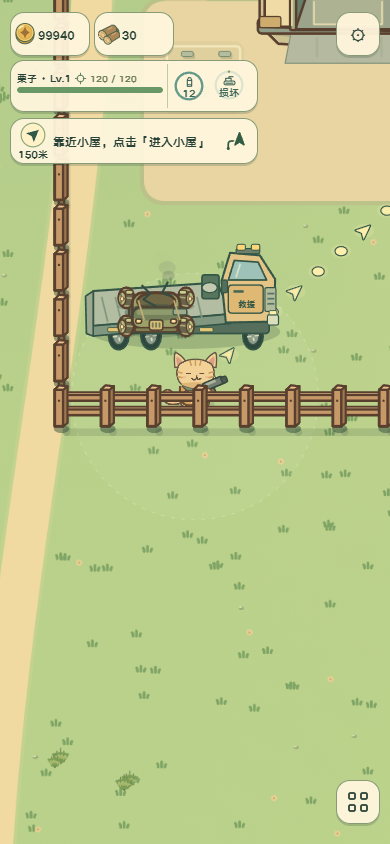
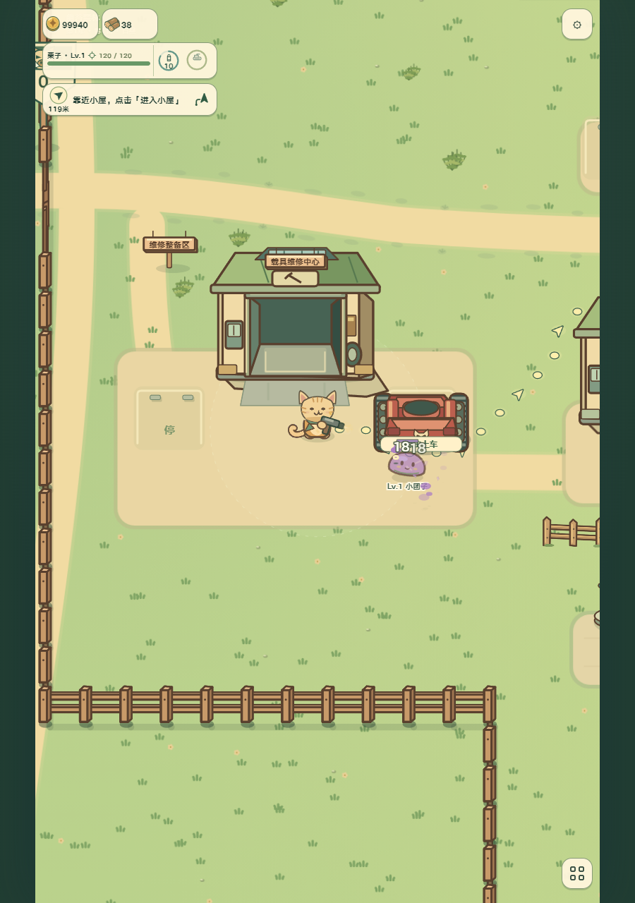
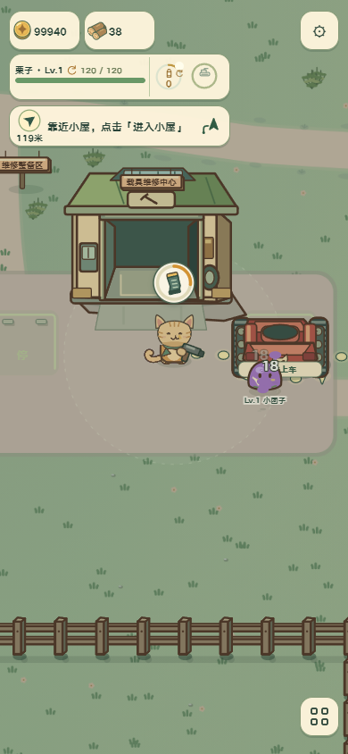

# 建筑实体、平板拖车与停车场交付任务单

依据：[美术标准](../art-generation-standard.md)与[仓库要求](../../AGENTS.md)，沿用任务单的六阶段记录。

## 1 目标与范围

本轮为程序美术与交互开发。修复车辆自动交付北门停车场；拖车重新设计为大型平板救援车，独立驾驶室、长载台、双后轴、绞盘、警示灯及上下车坡板。营地可进入房屋按功能重做立面：木石住宅、锻造工坊、种子温室、值守哨站、烟囱厨房与工业车库，消防和高塔保留专用入口结构并更新建筑细节。范围包括全部世界建筑实体碰撞，保留门口一秒进入、屋内售货员、P 停车、任务身份和价格。

制作路线为正式 Canvas 模块重绘，静态建筑与动态拖车分层，复用原猫猫连续帧、车体与独立炮塔。当前不替换成 PNG，不改变画风；后续静态美术精修可沿这些接口进行。参考为已有 docs/art-reference/repair-district-day.png 与正式场景中的建筑、车型。

## 2 造型与空间

采用三分之四俯视、森林绿轮廓、奶油墙体、石基和左上受光。不同建筑以屋顶剪影、窗型、功能附件区分；工坊有天窗、卷帘和梁柱，种子屋有玻璃温室窗，厨房有砖烟囱，哨站有钟和旗。建筑墙体、后墙实际阻挡步行及载具，库门通道与倒车轴线仍一致。拖车约 218×110，驾驶室位于车头、后方载台能容纳原尺寸战车；车轮随真实位移转动，装车时车体平移上载台，不将车身整图拉伸。

## 3 技术交付

建筑采用原底座锚点和可进入门位，完整世界实体几何在独立配置中登记，碰撞和通行查询复用同源坐标与周期镜像。图形分层为地坪、车架/建筑主体、独立车轮、载车、门框、灯光。建筑 Canvas 像素随既有 DPR 和场景缓存生成，不新增常驻纹理；拖车逐帧局部绘制，无外部资源依赖。正式入口为 src/rendering/vehicle-repair.js、garage.js 及各建筑绘制器；碰撞通过 physics/motion.js 统一执行。昼夜共用场景照明，静态屋顶季节沿原接口；图片精修在后续阶段保持门位、尺寸、分层和 ID。

## 4 动画任务补充

拖车采用游戏时间与轮相，暂停不推进；挂钩阶段将原残骸连续拖上载台，拖运车体和拖车共用位置。履带、枪械、猫动画不改。建筑本身静态，雪顶与窗光沿正式昼夜接口。无新视频或序列帧素材，仅录制实际运行作为证据。

## 5 生成指令

本轮不使用 imagegen：需要让实际墙体、车库开口、车辆载台和运动部件严格共用程序几何，以现有 Canvas 绘制实现独立可测试部件。没有伪造图片请求、源视频或解码预算。

## 6 验收记录

结论：本轮程序美术与交互通过，设计目标 `building-tow-redesign` 已绑定 `visual-contract.json` 和正式 `inspectBuildingTowRedesign`。后续 PNG 精修不计入本轮完成项。

- 自动交付、满位保管、避让行驶车辆、旧档续接、全建筑双轴高速/飞行与周期镜像碰撞、门口进入、维修车库泊位和消防出入库，共 38 项针对性单元检查通过。没有新增运行图片或解码预算。
- 居民增加正式碰撞绕行与多路点连续行走；厨房西移 85 单位让出栖架和车辆通路。道路、全天作息、暂停/重载与设施边界回归通过。关联三套检查共 26 项，其中 18 项通过，8 项失败已在未修改的 main 基线复现：种子屋旧购买约定 1 项、生活任务/安全场景旧夹具 6 项、直升机旧召车坐标 1 项；没有新增失败。
- 真实手机触摸从电话付费救援开始，连续经过到场、绞盘挂钩、平板载运、进站维修、满血自动停北门场；结果定位 north-0-1，HP 240/240、非驾驶状态，无页面异常。实际按键验证住宅挡墙，站门口进入种子屋。
- 实机截图覆盖 320×568、390×844、844×390、900×1280 昼夜，猫猫、怪物、载具与建筑同屏。逐项复核木石小屋、工业工坊、温室、哨站、厨房、车库、消防站、高塔及传奇工坊；描边与门槛落地一致，原猫动画及独立武器保留。
- 截图和连续录像在主检出目录 `output/playwright/building-tow/`，最终录制 `video/page@bfc6c9720dd30cc71c6346ccf333620f.webm`；旧失败尝试不作为验收证据。维修车库 P 操作实测也通过：点击 P 倒入、门口进入、售货员保养、自动入场及绕墙走位，无页面异常。追加记录在 `output/playwright/building-tow/camp-parking/`。
- 代表截图随源码保存：`docs/art-reference/building-tow-loaded.png`、`building-tow-day.png`、`building-tow-night.png`。正式绘制入口为 `drawBuildingArchitecture`、`drawVehicleServiceObject` 以及原建筑世界队列；没有独立替代预览。

