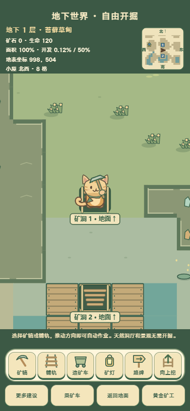
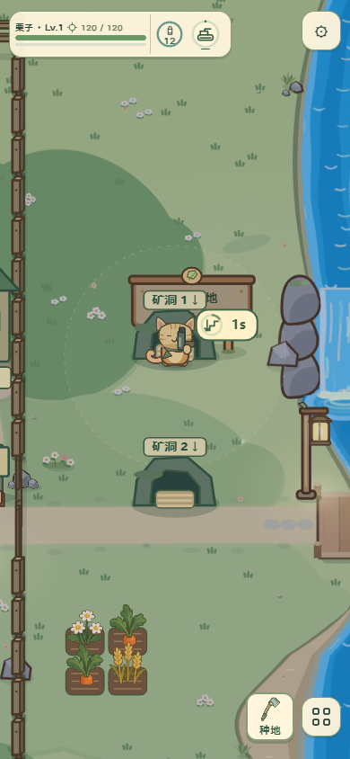
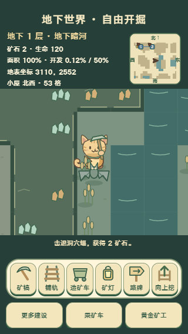
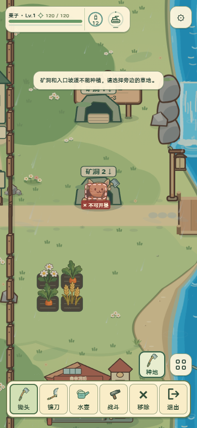

# 矿洞对应、进入与禁种修复

## 目标与参考
依据[美术标准](../art-generation-standard.md)、[项目合同](../../AGENTS.md)。本轮为程序动态修复，参考用户两个地表矿洞截图和现有梯口、动作倒计时；不生成新位图。修复地下景观覆盖梯口、小地图裁掉远处洞口；地表点击走近、站立1秒显示倒计时；洞口与坡道不得种植。

## 结构、锚点与保留
洞口沿用原石拱、木梯与森林配色，世界位置不变，地表和地下使用同一个存档键及显示编号。洞口周围九格平台留出景观空间；梯口与猫身体维持独立，标签在界面层可读。透明点击区对应既有石拱108×96世界单位，最小44px。倒计时复用原动作徽记68×34，与地面入口侧边锚定；手机320/390宽及横向短屏复核。

只改变入口可见性与命中，不新增碰撞墙体，不开掘两个洞口之间的道路。小地图仍224×224（200704字节），远端标记压到边缘，保留小屋、方向和层间坡道。原猫视频连续帧、手持武器、怪物和载具动作全部保留；本轮无新增动作帧、图集或PNG，PNG精修不适用。运行资源沿用正式加载失败规则。

## 实现入口
正式入口src/rendering/mining.js、src/rendering/player-action-countdown.js、src/ui/world-workshop.js；designCriterion为mine-entrance-links。地图几何与禁种共享src/world/mine-entrances.js，数值保留src/config/mining.js；实际进入由src/core/mining.js提交。倒计时随游戏时间，暂停冻结，移动取消，出洞防回弹，明确点击可重新进入。

## 验收
| 设计目标 | 实际验收结果与证据 |
| --- | --- |
| 两洞共享一层、梯口不被景观遮住 | 手机真实短按第一洞口，地下一层同时绘出7,3和7,6两个梯口；编号1/2与地表一致，第二洞口可返回对应地表坐标，再次明确点击可重入，刷新仍保留两处。two-exits-day/night.png。 |
| 远处入口始终有指向 | 走出小地图范围后两处号码在边缘保留，方向接近时错位避让，引线指向原点；320×568与844×390各昼夜一组，未新增桌面布局。edge-320/844-day/night.png。 |
| 点击走近、站立倒计时、起停正确 | 使用真实触屏短按透明石拱热点，角色实际行走到洞口，站定1秒进入；移动取消、暂停冻结、切换入口重计时、出洞防回弹及战车倒计时通过核心测试。昼夜正式徽记截图countdown-day/night.png；为抓取短暂候停帧仅冻结已到达时的模拟循环，保留游玩态绘制，拍完恢复。 |
| 洞口不能种植 | 实际点击「种地」并点洞口，红色预览与「矿洞和入口坡道不能种植」提示出现，田块与资源未变化。旧空田不能排队播种或提交播种，允许收获和移除；反向开洞也不能覆盖已有田块。farm-blocked.png与专项测试。 |
| 昼夜、触控、遮挡与空间 | 人工复核两梯口、地表石拱、原猫、天然景观、倒计时和短屏地图；透明热点约91.8×81.6px，超过44px，无横向溢出。入口平台清出景物、实际通行仍沿用原碰撞；没有在两洞之间自动开路。 |
| 动作与资源预算 | 沿用猫真实视频帧和独立手持工具，测试录像在output/playwright/mine-entrances/video/；新运行位图0字节，复用224×224小地图及正式倒计时绘制。没有增加猫帧、履带、旋翼和怪物动作资源，因此不重复这些资产生产检查。资源加载无pageerror。 |

针对性结果：tests/mine-entrances.test.mjs 7/7；挖矿和点击行走既有回归19/19；房屋出门倒计时6/6。实际浏览器双洞往返、10张手机画面、刷新保存及单独追加的真实种植点击均通过。未运行全量npm test。

附带执行的旧tests/farm-placement.test.mjs有4项失败（旧固定坐标的路边开垦、预览队列、取消及设施判定），在未修改main上复现这些失败；基线还出现一项旧档田块失败。本轮不修改旧坐标夹具，保留adjacent.log与baseline-farm.log说明验证边界。

证据目录output/playwright/mine-entrances/包含review.log、farm-review.log、unit.log、regression.log及录像。默认脚本使用4175；本次保留原4175服务，临时工作树使用4176执行同一测试。

正式绘制与验收入口：src/rendering/mining.js#drawMining、src/rendering/player-action-countdown.js#drawPlayerActionCountdown、src/rendering/visual-review.js#inspectMineEntrances；designCriterion：mine-entrance-links。

动态修复结论：通过，本轮三项修复无未完成项。PNG替换不适用（未新增图片资产），未来美术精修另立任务。

长期参考图（正式运行，2026-11-03）：

