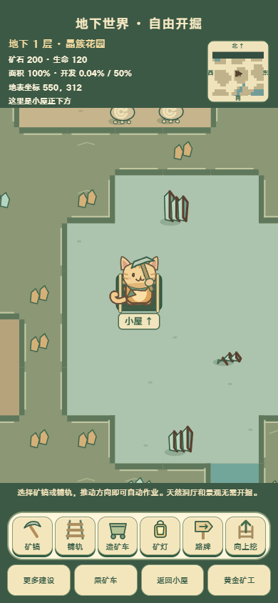
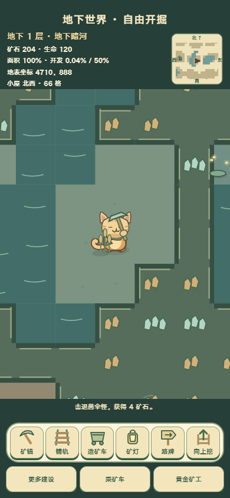
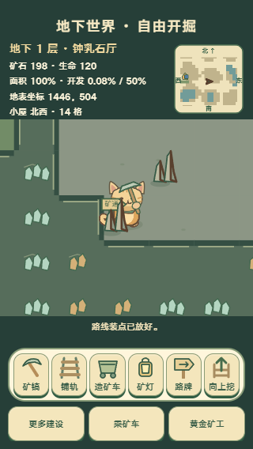
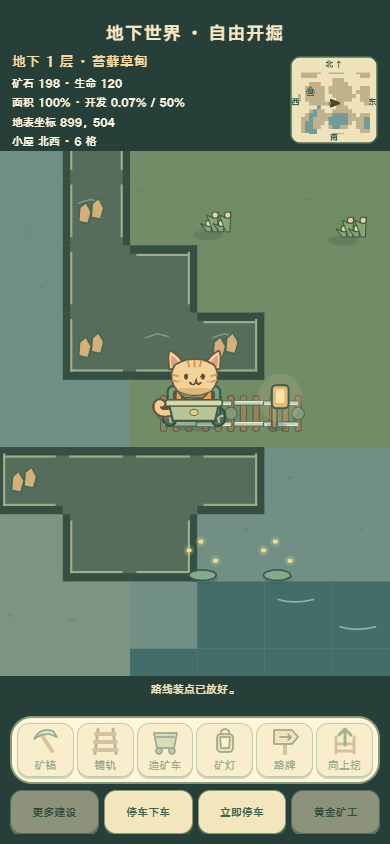

# 地下快捷工具与天然洞厅任务单

## 1 目标与阶段
动态开发：按种植工具栏改为六个图形快捷按钮（矿镐、铺轨、矿车、矿灯、路牌、向上挖），移动时自动开采或铺轨。景观天然存在，不再随挖掘生成；地下没有预制道路。沿用HTML/CSS/Canvas和原猫真实连续帧。

## 2 参考与结构
参考用户两张截图、现有种植工具栏与地下九种景观。天然洞厅为成片不规则空腔，保留岩层可开掘；水域、岸线、通行使用同一坐标判定。取消逐格矿砖和道路底色；岩层连接为连续块面。已有轨道与桥梁为玩家设施，继续显示。

## 3 尺寸与分层
世界逻辑64单位网格保持，画面隐藏整齐格线，仅当前作业目标显示轮廓。快捷图标为28×28独立SVG，按钮至少44×44；短屏图标缩小但触区不缩小。地面、水、岩体、景观、轨道、人物和特效分别绘制，脚底排序沿用。没有新增位图或图集。昼夜同一形体不同材质色，原猫、矿车轮毂及怪物独立动作保留。

## 4 规则与存档
开层种子保持稳定，天然洞厅不预写全图；实际走到的天然地块才累计开发率，开掘岩层按原规则产矿；分母仍为本层全部面积。设施、桥梁、采集冷却、生物状态可在天然地块保存。旧矿道、层级、景观种子及设施保留。暂停、乘车和小游戏期间停止自动施工；资源不足或保存失败停止铺轨，避免逐帧扣费与刷提示。

## 5 实现路线
不调用imagegen：本轮扩展已有程序绘制与SVG动态原型。后续精修PNG不在本任务内。正式入口src/rendering/mining.js与src/rendering/mine-ecology.js，快捷栏src/ui/mining.js。designCriterion为mining-tools-natural-caves。

## 6 验收
执行依据：[美术资源标准](../art-generation-standard.md)、[项目合同](../../AGENTS.md)。本轮为程序绘制和SVG动态开发，PNG精修属于后续阶段。

| 设计目标 | 实际验收结果与证据 |
| --- | --- |
| 六个快捷工具可辨、触控可用 | 矿镐、双轨、矿车、灯笼、路牌、上行梯六种轮廓，保留中文标签与选中态；320/390宽及844×390横屏均无溢出，最小触区44px。见下方长期参考图。 |
| 天然景观无需挖出、没有预制道路 | 正式种子1847定位九种未开发景观，开掘键均不存在；九景昼夜共18张截图。岩体连续连接，仅洞厅边缘描边，挖开岩层不会凭空生成景观。 |
| 通行与真实边界一致 | 正式碰撞测试覆盖天然干地、水域、岩壁、建桥和分层边界；天然干地可直接进入，水面建桥后可走，地图外不可走。沿用原战车体积与两栖规则，本轮未修改战车美术或武器。 |
| 移动施工与停止正确 | 真实触屏拖动开采和连续铺轨；松手停止挖掘，已有轨道不重复扣料。斜向输入沿主方向铺轨，转弯后轨段四向连通。材料不足或保存失败立即停止，旧资源与进度保持不变。 |
| 矿车与快捷建设 | 实际点击造车、灯、路牌、乘坐、开车及立即停车，轮毂按真实移动推进；向上挖进度、取消、完成均通过。弹窗期间冻结施工，刷新恢复种子、勘探、轨道、摆件和洞口。 |
| 动作、遮挡与落地 | 原猫连续身体帧及独立矿镐保留，未增加或变形身体帧；景观按脚底排序，矿车前后车厢独立绘制。触屏移动、挥镐、开车和停车录像见output/playwright/natural-mining/video/。本轮没有新增枪、履带或旋翼资产，无需重复这些资产的动作验收。 |
| 昼夜同屏与中文可读 | 已人工检查entry、mushroom-day、river-night、cart-driving、tools-320-night和tools-844-day；使用正式昼夜历法，森林绿、奶油黄和柔和草木色统一。层名、小地图、工具栏不遮挡中央活动区。 |
| 预算、素材与失败行为 | 新增运行位图0字节，6个内联SVG；复用224×224地图画布200704字节，无新增昼夜位图副本或派生缓存。只绘制可见网格（本次手机取景45至99格）；正式浏览器启动加载原猫资源，pageerror为0，不增加素材缺失备用画面。 |
| PNG精修替换 | 后续阶段，本轮未生成PNG游戏资产；下方PNG仅为验收截图，不进入游戏运行包。 |

针对性测试：tests/natural-mining.test.mjs 8/8；既有挖矿与生态25/25；原子存档修正后相关保存、施工、采集和开层案例8/8。未执行全量npm test。正式浏览器tests/natural-mining-browser.cjs验证29个画面及触屏交互，证据位于output/playwright/natural-mining/。默认测试端口仍为4175，本次为保留已运行服务，在临时工作树以4176执行同一脚本。

正式绘制器：src/rendering/mining.js#drawMining、src/rendering/mine-ecology.js；验收入口：src/rendering/visual-review.js#inspectNaturalMining；designCriterion：mining-tools-natural-caves。

动态开发结论：通过。PNG精修：后续阶段。没有未处理的本轮退回项。

长期参考图（正式游戏截图，2026-11-03）：

