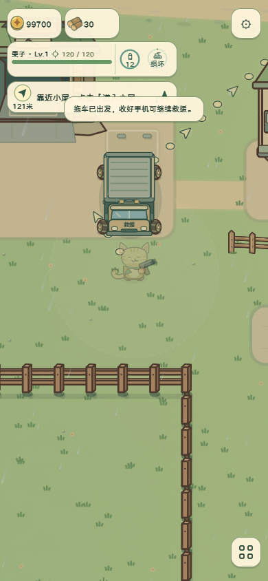
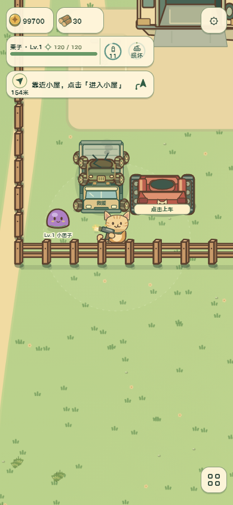
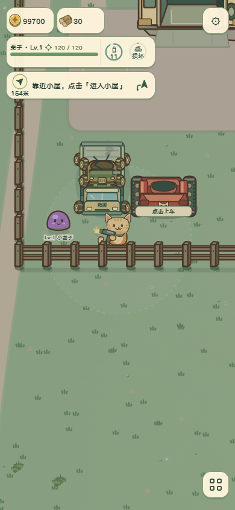

# 救援车正面俯视改造任务单

依据：[美术标准](../art-generation-standard.md)与[仓库合同](../../AGENTS.md)。

## 1 目标与范围

本轮为程序美术修订，稳定标识 `tow-front-view`。用户要求救援车缩小，与所有现有载具统一车头朝下俯视角。沿用正式 Canvas 绘制及消防车、松果战车的轮胎，不生成额外位图。参考 `src/rendering/fire-truck.js`、`pine-wheels.js` 的真实正面车壳。

## 2 结构与造型

车宽从 218 缩至 108 世界单位，正面驾驶室在画面下方，紧凑载台在上方；总长约 142。固定朝下，不随横向移动镜像或旋转整车。左右对称四轮、短前脸、风挡、保险杠与小警灯统一现有车辆语言；原载具以原比例放在载台，绞盘钢索连续收拢。

## 3 技术交付

保持拖车世界脚底锚点与路线，货物锚点改为 `(0,-50)`，不随路线方向变化。顺序为阴影/轮胎/载台、货物/绑带、前驾驶室。挂钩和拖运共用正式绘制器，避免载台盖住被救车辆；货物保留独立车体和炮塔。碰撞寻路半径仍为 34，旧订单无需改价或重置。新增运行位图、纹理与解码预算均为零。

## 4 动画任务补充

四轮复用原载具位移相位胎纹，车体不变形。挂钩两秒连续收拢，拖运保持载台偏移不跳位，暂停不推进动作。猫猫真实连续帧与独立武器保持。录制正式游戏，而非替代展示。

## 5 生成方式

本轮使用程序几何，因为轮胎、载台和挂钩必须独立运动；imagegen 与 PNG 精修留待后续阶段，不声明已生成图集。

## 6 验收记录

结论：通过本轮程序美术验收，`tow-front-view` 已绑定 `visual-contract.json` 与正式 `inspectTowFrontView`。

- 19 项针对性检查通过，包括四向装载锚点一致、挂钩残骸仅绘制一次、紧凑尺寸、暂停/读档续接、0.5 修复系数和自动停车交付。
- 真实手机电话救援依次经过出车、挂钩、装载、拖回、维修和北门自动入场，15 个浏览器检查点通过，无页面异常。交付车辆 HP 240/240，位置 north-0-1。
- 正式场景已检查 320×568、390×844、844×390 与 900×1280 白天/夜晚。救援车、原尺寸松果战车、红狼、猫猫与怪物同屏，车头视角一致；短屏调整观察站位让车辆避开原 HUD。首次暂停菜单遮住车辆的截图不作为验收，最终通过对原更新输入零步长进行光照定格，仍由正式世界队列绘制。
- 四轮使用原载具真实位移胎纹；装车时货物连续向上方载台收拢，车头在货物前方，转弯不镜像。独立猫动画、武器与原车体保留。无新增运行位图、解码或贴图预算；PNG 精修属于后续阶段。
- 主检出目录保留 `output/playwright/tow-front/` 的实机截图，最终连续录像为 `video/page@309ceb537b92decb6408ce72686898fe.webm`。随源码保存代表截图如下。

